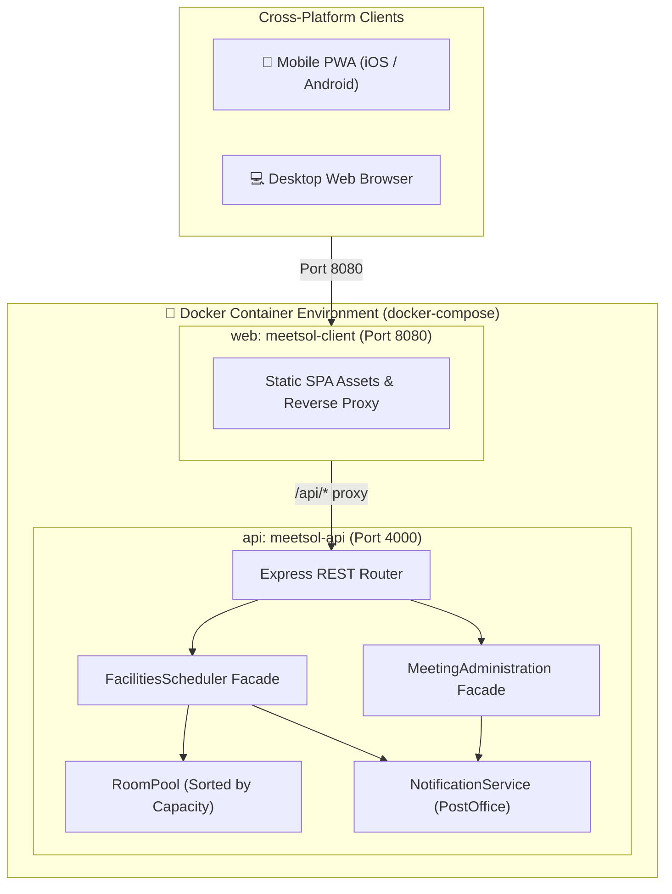

# 🏢 MeetSol - Meeting Room & Facilities Scheduling Platform

A modern, containerized, cross-platform meeting room scheduling platform built entirely without Python in **TypeScript (Node.js)** with responsive **Mobile (PWA) & Web UI**, designed directly from the architectural specification in **`MeetSol.PDF`** (*Objective Engineering, Inc.*).

---

## 🌟 Core Features & OOAD Implementation

- **Capacity-Optimal Room Allocation (`RoomPool`)**:
  - Automatically identifies and reserves the **smallest available room** that meets or exceeds the required attendee capacity.
  - Prevents resource waste (e.g. allocating a 60-person auditorium for a 4-person sync).
- **Dual Facade Architecture**:
  - `MeetingAdministration`: Manages reusable meeting definitions, rosters, and attendee updates.
  - `FacilitiesScheduler`: Manages concrete room time slots, reservations, and cancellations.
- **Cascade Cancellation Logic**:
  - If a meeting definition is deleted, all future scheduled instances are automatically canceled and their rooms are released.
  - If the **last attendee** is removed from a meeting, all future occurrences are automatically canceled and their rooms are freed.
- **Electronic Notifications (`PostOffice`)**:
  - Dispatches invitations and cancellation retractions to attendees, with full dispatch logging.
- **Mobile & Web UI**:
  - Responsive single-page application with bottom navigation tabs, touch-friendly controls, and PWA capability (*Add to Home Screen* on iOS and Android).

---

## 🏗️ Architecture Overview



---

## 🚀 Running Live with Docker

You can spin up the complete environment with a single command:

```bash
docker compose up -d --build
```

### Accessing the Services

| Service | URL | Description |
| :--- | :--- | :--- |
| **Mobile & Web App** | [http://localhost:8080](http://localhost:8080) | Interactive scheduler, roster manager, and room browser |
| **Backend API** | [http://localhost:4000/api](http://localhost:4000/api) | Direct REST endpoints |
| **Health Check** | [http://localhost:4000/api/health](http://localhost:4000/api/health) | Docker container health monitoring |

To check container logs:
```bash
docker compose logs -f
```

To stop the containers:
```bash
docker compose down
```

---

## 📡 API Reference

### 1. Facilities & Scheduling (`/api/facilities`)
- `GET /api/facilities/scheduled`: List all scheduled meetings.
- `POST /api/facilities/schedule-meeting`: Schedule a meeting (`{ meetingName, startTime, endTime }`) with capacity-optimal room assignment.
- `POST /api/facilities/schedule-room`: Direct room reservation (`{ size, startTime, endTime, purpose }`).
- `DELETE /api/facilities/scheduled/:id`: Cancel meeting & release room.
- `GET /api/facilities/notifications`: View recent electronic mail notifications.

### 2. Meetings Administration (`/api/meetings`)
- `GET /api/meetings`: List all meeting definitions.
- `POST /api/meetings`: Define meeting (`{ name, attendees: ["email1", "email2"] }`).
- `POST /api/meetings/:name/attendees`: Add attendee (`{ employeeId }`).
- `DELETE /api/meetings/:name/attendees/:employeeId`: Remove attendee (triggers cascade if empty).
- `DELETE /api/meetings/:name`: Delete meeting (cascades cancellations).

### 3. Room Pool (`/api/rooms`)
- `GET /api/rooms`: List all rooms with capacities and active interval assignments.
- `POST /api/rooms`: Add a new room (`{ location, capacity }`).

---

## 📦 Pushing to GitHub

To push this repository to your GitHub account:

1. **Create a new repository** on [github.com/new](https://github.com/new) (e.g. named `meeting-room-scheduler`). Do not initialize with README or .gitignore.
2. **Link and push** from your terminal:

```bash
git remote add origin https://github.com/<YOUR-USERNAME>/meeting-room-scheduler.git
git branch -M main
git push -u origin main
```

A pre-configured **GitHub Actions CI workflow** is included in [`.github/workflows/docker-ci.yml`](.github/workflows/docker-ci.yml) that automatically builds the Docker containers and verifies healthchecks on every push.
